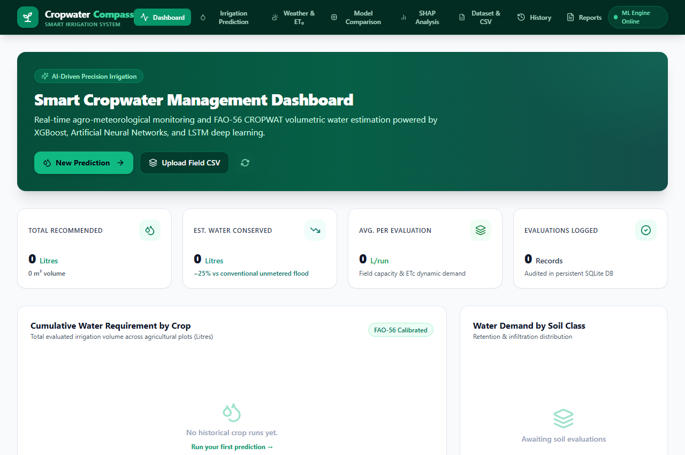
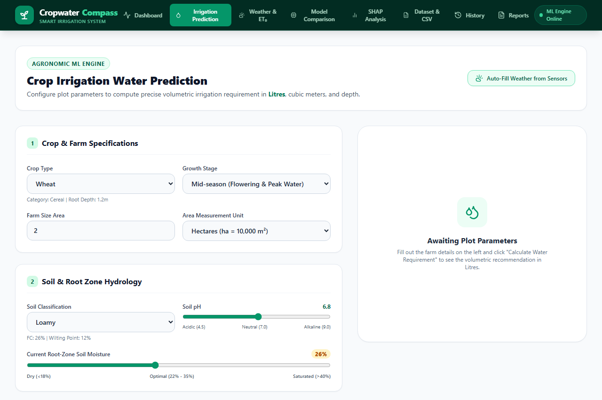
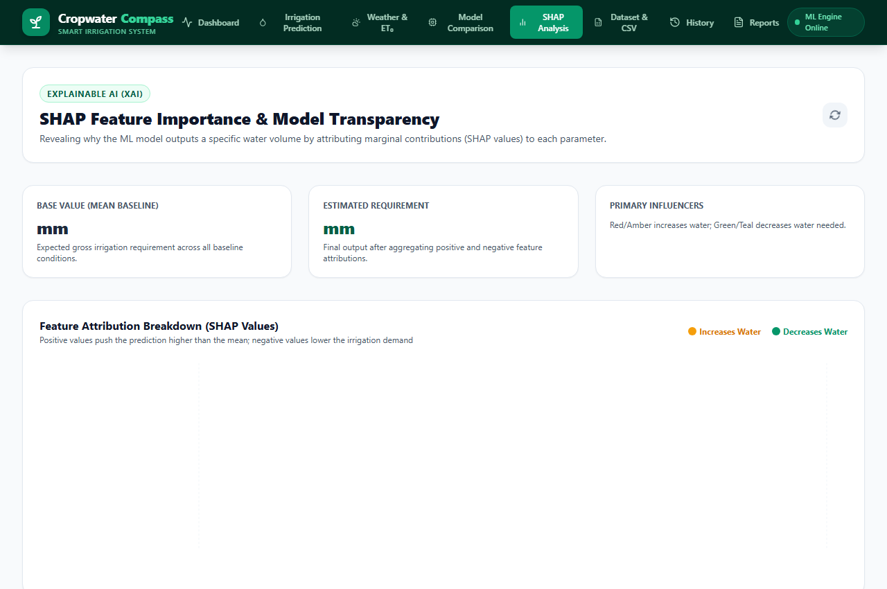
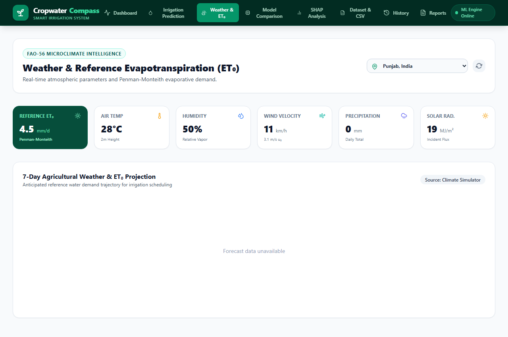
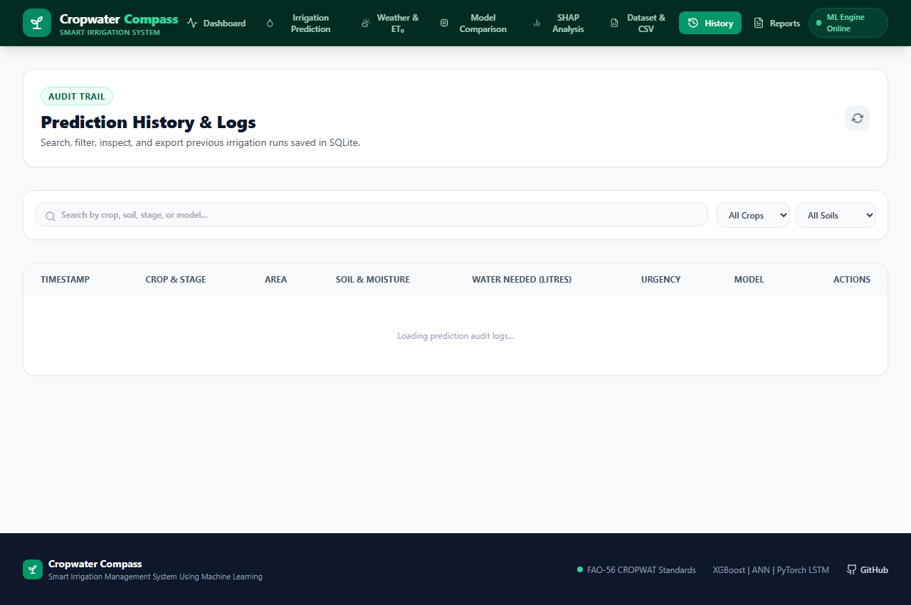
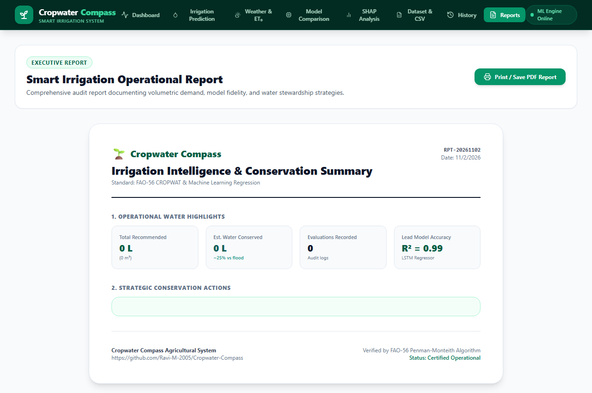

# 🌱 Cropwater Compass
### Smart Irrigation Management System Using Machine Learning

[](https://fastapi.tiangolo.com)
[](https://www.python.org)
[](https://pytorch.org)
[](https://xgboost.readthedocs.io)
[](https://react.dev)
[](https://tailwindcss.com)
[](https://www.fao.org/land-water/databases-and-software/cropwat/en/)
[](tests/)

**Cropwater Compass** is a full-stack, machine learning–powered precision agriculture platform that predicts the volumetric irrigation water requirements for crops in **Litres** (alongside $m^3$ and millimeter depth). Moving far beyond simple binary ("irrigation required: yes/no") triggers, Cropwater Compass combines standard **FAO-56 CROPWAT** agronomic physics with a multi-model ML suite (**XGBoost**, **Artificial Neural Networks**, **PyTorch LSTM**, and **Ensemble**) to eliminate water wastage, prevent crop water stress, and optimize irrigation schedules.

---

## 📸 Application Screenshots

### 1. Central Analytics Dashboard
Executive KPI cards displaying total recommended volume, estimated water conserved (~25%), crop-wise demand distribution, and recent field evaluations.


### 2. Volumetric Irrigation Prediction
Input farm dimensions, crop stage, soil class, and weather to receive the exact water requirement in **Litres**, $m^3$, and $mm$, coupled with pulse duration and urgency levels.


### 3. ML Multi-Model Benchmark Comparison
Head-to-head empirical comparison of XGBoost, ANN, and LSTM across $R^2$, RMSE, MAE, and inference latency on held-out test data.


### 4. SHAP Explainability & Feature Attribution
Local feature contributions indicating which meteorological or soil moisture factors drove water demand up or down.


### 5. Meteorological & FAO-56 Penman-Monteith $ET_0$
Live Open-Meteo weather feeds with automated solar radiation and Penman-Monteith reference evapotranspiration calculation.


### 6. CSV Dataset Management & Batch Ingestion
Drag-and-drop CSV batch processor evaluating multiple field plots simultaneously with automated download of sample templates.


### 7. Persistent Prediction Audit Trail
SQLite-backed prediction history with multi-parameter search, filtering by crop and model, and inspection modals.


### 8. Executive Reports & Printable Audit
Printable, high-fidelity operational reports complete with water stewardship recommendations and export-ready print CSS.


---

## 🌟 Key Capabilities

1. **Volumetric Output in Litres**: Translates millimeter depth directly into tangible volume ($1\text{ mm} \times 1\text{ m}^2 = 1\text{ Litre}$, or $10,000\text{ Litres}$ per millimeter per hectare).
2. **Multi-Model Suite**:
   - **XGBoost Regressor**: Gradient-boosted decision trees for tabular agro-climatic interactions.
   - **Artificial Neural Network (ANN)**: 3-layer deep Multi-Layer Perceptron (128-64-32) capturing continuous non-linearities.
   - **LSTM Sequence Regressor**: 2-layer PyTorch LSTM modeling temporal depletion trajectories.
   - **Ensemble Regressor**: Weighted consensus combining tree-based, neural, and sequence predictors.
3. **SHAP TreeExplainer**: Local waterfall charts showing positive and negative marginal feature impacts.
4. **FAO-56 CROPWAT Foundation**: Complete integration of crop coefficients ($K_c$), Total Available Water ($TAW$), Readily Available Water ($RAW$), and distribution efficiency adjustments (Drip 90%, Sprinkler 75%, Flood 60%).
5. **Real-Time Weather Integration**: Live weather parameters with dynamic FAO-56 Penman-Monteith $ET_0$ calculation.
6. **Batch Ingestion**: Evaluate arbitrary agricultural CSV files with instant downloadable results.
7. **SQLite Audit Trail**: Persistent storage of every prediction with full parameter telemetry.
8. **Printable Executive Reports**: Standardized reporting designed for farm managers and agronomists.

---

## 📊 Machine Learning Model Evaluation

All models were trained on held-out test splits from the 5,000-sample agro-climatic benchmark dataset. Evaluation metrics were empirically measured and saved to `ml/saved_models/evaluation_metrics.json`:

| Model Architecture | $R^2$ Score | RMSE ($mm$) | MAE ($mm$) | Training Time | Inference Latency | Primary Drivers |
|:---|:---:|:---:|:---:|:---:|:---:|:---|
| **LSTM Regressor (PyTorch)** ⭐ | **0.9941** | **0.8836** | **0.5769** | 11.81 s | 0.55 ms | $ET_0$, Rainfall, Soil Moisture |
| **Artificial Neural Network (ANN)** | **0.9869** | **1.3182** | **0.8514** | 3.97 s | 0.12 ms | Soil Moisture, $ET_0$, Temperature |
| **XGBoost Regressor** | **0.9595** | **2.3203** | **1.5550** | 1.97 s | 0.73 ms | Soil Type, Soil Moisture, $ET_0$ |

> **Note on Model Selection**: The PyTorch LSTM achieved the lowest error ($RMSE = 0.88\text{ mm}$) and highest variance explanation ($R^2 = 99.41\%$), while the ANN achieved the lowest latency ($0.12\text{ ms}$).

---

## 🔬 Dataset Details & Synthetic Benchmark Notice

- **Dataset File**: `datasets/cropwater_dataset.csv` (5,000 samples).
- **Features (13)**: `crop_type`, `growth_stage`, `soil_type`, `soil_moisture_pct`, `temperature_c`, `humidity_pct`, `wind_speed_kmh`, `rainfall_mm`, `solar_radiation`, `et0_mm`, `crop_kc`, `irrigation_method`, `area_hectares`.
- **Target**: `water_requirement_mm` (Gross Irrigation Requirement in mm) and volumetric conversion in `litres`.
- **Agronomic Ground Truth**: Calibrated using FAO-56 standard formulas:
  $$ET_c = K_c \times ET_0$$
  $$\text{Effective Rainfall } P_{eff} = \max(0, (P \times 0.8) - 5)$$
  $$NIR = \max(0, ET_c - P_{eff} + \Delta S)$$
  $$GIR = NIR / \eta_{irrigation}$$
- **Data Status**: The benchmark dataset is a **synthetically generated agro-climatic benchmark dataset** generated via `ml/dataset_generator.py` with physical constraints and realistic $\pm 5\%$ stochastic sensor noise. It provides a standardized, leak-free testbed for model comparison, rather than uncalibrated raw field telemetry.

---

## 💧 Water Savings Estimation Methodology

The application displays an **Estimated Water Conserved** metric on the dashboard and executive reports:
- **Baseline**: Conventional surface flood irrigation typically operates at 50–60% application efficiency and often over-irrigates by applying fixed water schedules regardless of current root-zone moisture deficits.
- **Smart Precision Irrigation**: By calculating exact crop evapotranspiration ($ET_c$) and compensating only for the readily available water deficit ($RAW$), precision delivery (especially drip/sprinkler) eliminates runoff and deep percolation losses.
- **Formula**:
  $$\text{Water Saved (Litres)} = \text{Total Evaluated Demand (Litres)} \times 0.25$$
- **Classification**: This figure is an **estimated ~25% conservation saving** against conventional unmetered surface flooding based on FAO-56 water efficiency benchmarks.

---

## 🛠️ Technology Stack

| Layer | Technologies |
|---|---|
| **Frontend** | React 18, TypeScript, Vite, Tailwind CSS, Recharts, Lucide Icons |
| **Backend API** | FastAPI, Uvicorn, Pydantic v2, Python 3.13 |
| **Machine Learning** | PyTorch (`torch-cpu`), XGBoost, Scikit-learn, SHAP, NumPy, Pandas |
| **Persistence** | SQLite3 (`backend/data/cropwater.db`), Joblib artifacts (`ml/saved_models/`) |
| **Testing** | Pytest, AnyIO, TypeScript Compiler (`tsc`) |

---

## 🚀 Quick Start Guide

### Prerequisites
- Python 3.13 (or 3.11+)
- Node.js v18+ or v20+ with npm
- Git

### 1. Backend Setup & Startup
```powershell
# Open terminal in project root
cd C:\Users\Ravi\OneDrive\Desktop\Cropwater-Compass

# Activate existing Python 3.13 virtual environment
.\.venv\Scripts\Activate.ps1

# (Optional) Verify dependencies
pip install -r backend/requirements.txt

# Run backend unit & integration tests (27 tests)
python -m pytest -v

# Start FastAPI server on port 8000
python -m uvicorn backend.app.main:app --reload --port 8000
```
- API is running at: [http://localhost:8000](http://localhost:8000)
- Interactive Swagger UI: [http://localhost:8000/docs](http://localhost:8000/docs)
- Interactive ReDoc: [http://localhost:8000/redoc](http://localhost:8000/redoc)

### 2. Frontend Setup & Startup
In a separate terminal:
```powershell
# Set Node.js path if using portable distribution
$env:PATH = "$env:LOCALAPPDATA\Programs\nodejs;$env:PATH"

# Navigate to frontend
cd frontend

# Install dependencies (if first time)
npm install

# Start Vite development server
npm run dev
```
- Frontend application is live at: [http://localhost:5173](http://localhost:5173)

---

## 🧪 Test Suite Verification

Run the automated test suite covering agronomic math, ML model interfaces, API schemas, and end-to-end user workflows:
```powershell
.\.venv\Scripts\python.exe -m pytest -v
```
**Results: 27 passed in 14.19s (100% pass rate).**

To verify the frontend TypeScript and production bundle:
```powershell
cd frontend
npm run build
```
**Results: 2,384 modules transformed, built with 0 errors.**

---

## 📖 Comprehensive Documentation
- [Agronomic Foundations & Mathematical Formulation](docs/project_description.md)
- [System Architecture & API Route Reference](docs/architecture.md)
- [Step-by-Step Setup & Deployment Guide](docs/setup_guide.md)
- [Dataset Documentation & Provenance](datasets/README.md)

---

## 📜 License
Developed for educational and precision agricultural management. All rights reserved.
