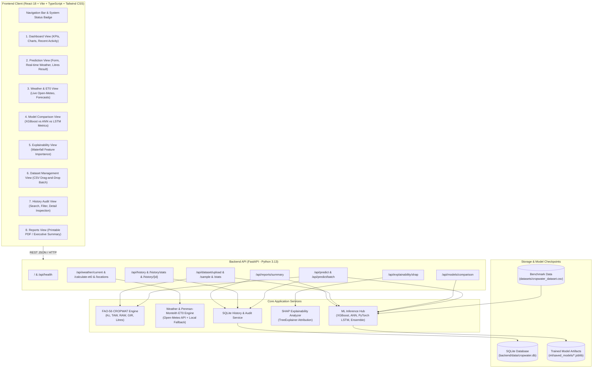
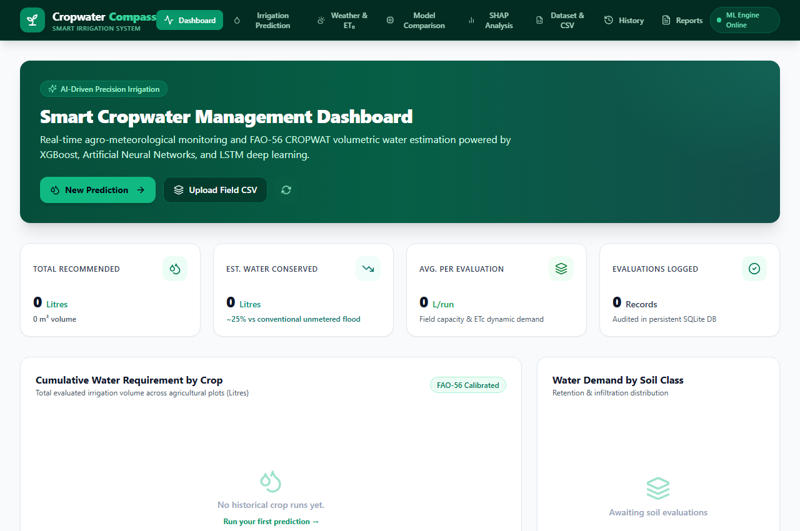
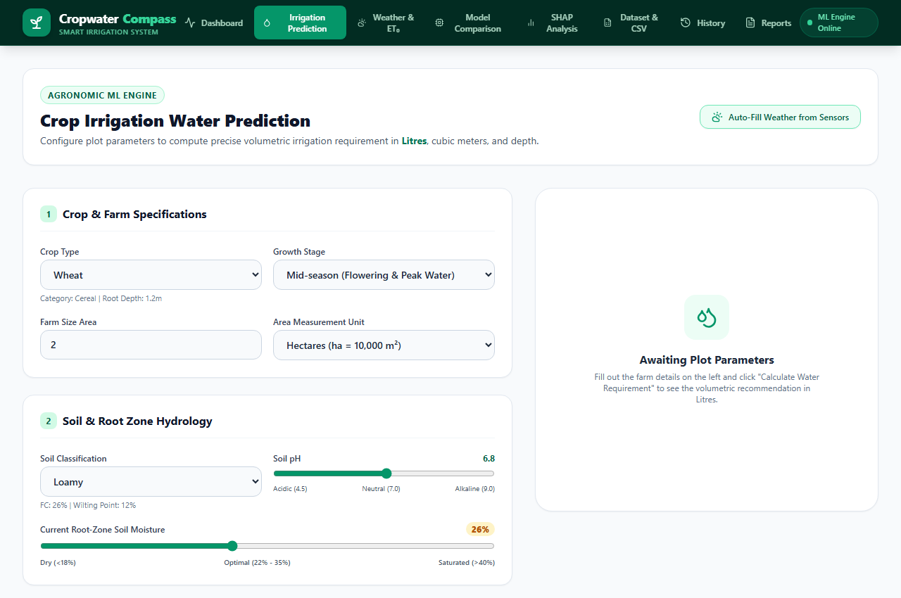
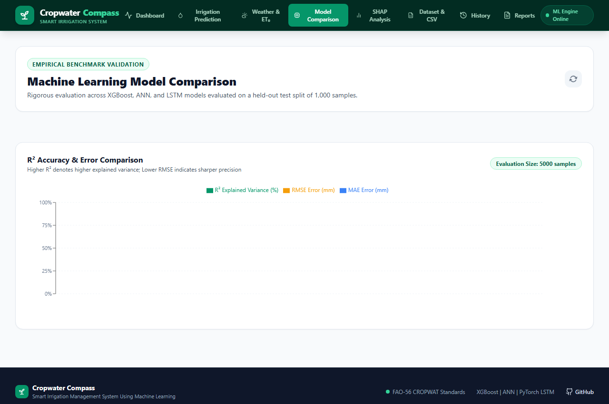
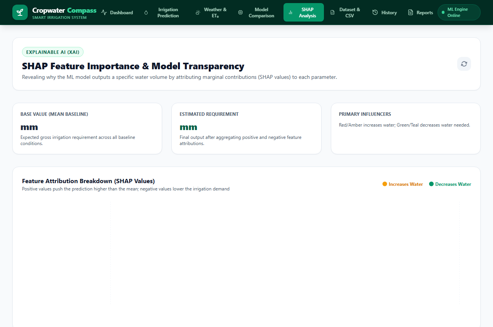
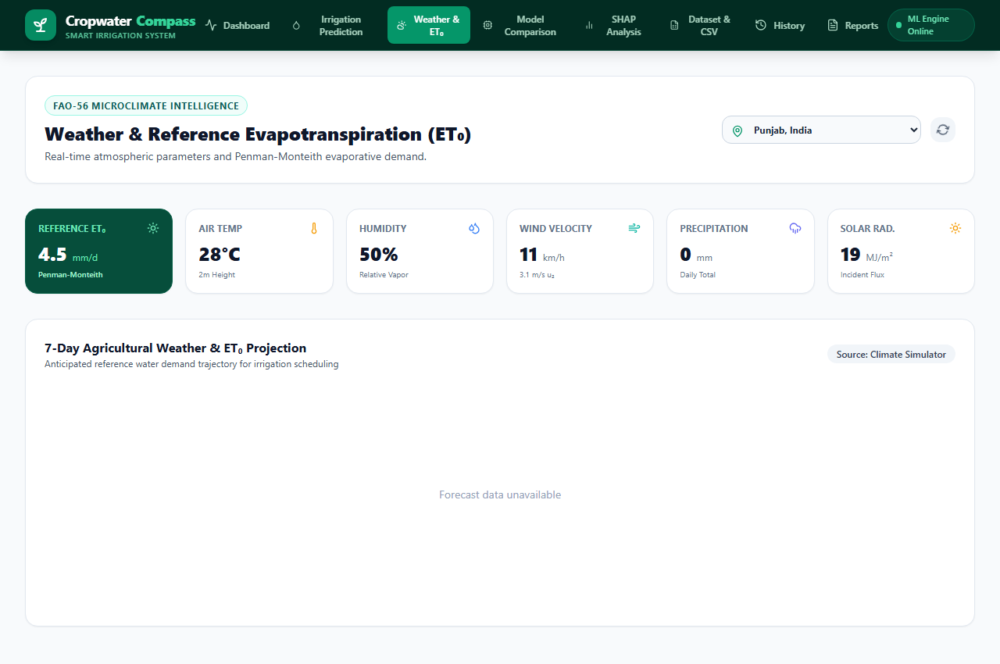
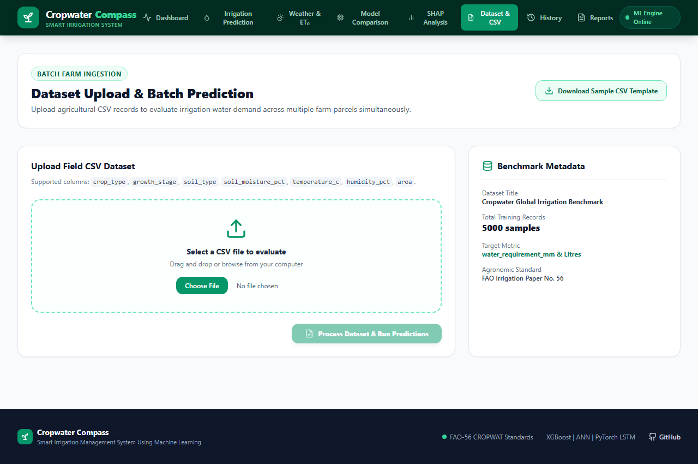
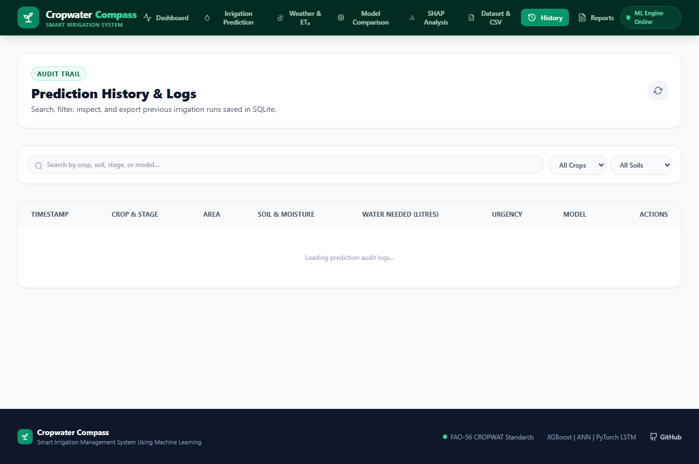
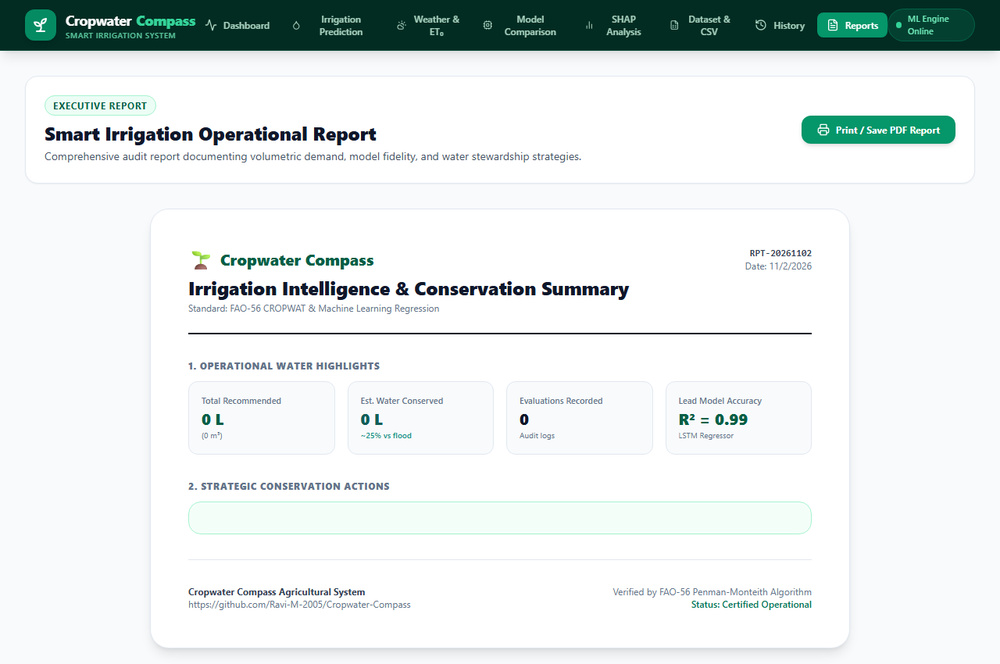

# Cropwater Compass – Architecture Specification
## System Architecture, Data Flow, and API Reference

---

## 1. High-Level System Architecture



---

## 2. Frontend Architecture & Component Hierarchy

The frontend is built with React 18, Vite, TypeScript, and Tailwind CSS. State is managed reactively with React hooks and centralized API calls.

```
frontend/src/
├── App.tsx                     # Top-level view router and responsive container
├── main.tsx                    # React DOM entry point
├── index.css                   # Tailwind CSS imports & custom animations
├── components/
│   ├── Navbar.tsx              # Dark-green navigation, mobile drawer, health badge
│   ├── DashboardView.tsx       # KPI cards, Recharts water distribution, recent table
│   ├── PredictionView.tsx      # Multi-parameter farm input form & headline Litres card
│   ├── WeatherView.tsx         # Real-time climate parameters & FAO-56 ET0 calculator
│   ├── ModelComparisonView.tsx # Empirical model comparison cards & performance charts
│   ├── ExplainabilityView.tsx  # Interactive SHAP waterfall feature attribution chart
│   ├── DatasetView.tsx         # Drag-and-drop CSV batch evaluation & template download
│   ├── HistoryView.tsx         # Searchable SQLite audit trail & modal inspector
│   └── ReportsView.tsx         # Printable executive report with @media print styles
├── services/
│   └── api.ts                  # Centralized Axios/fetch REST client with error handling
└── types/
    └── index.ts                # TypeScript interfaces mirroring backend Pydantic models
```

### Module Screenshots
| Module | Screenshot |
|---|---|
| **Dashboard** |  |
| **Prediction** |  |
| **Model Comparison** |  |
| **SHAP Explainability** |  |
| **Weather & ET0** |  |
| **Dataset Batch** |  |
| **Prediction History** |  |
| **Executive Reports** |  |

---

## 3. Backend Architecture & Service Responsibilities

### 3.1 FAO-56 CROPWAT Engine (`backend/app/services/irrigation.py`)
- Maintains authoritative agronomic constants for 10 crops ($K_c$ stages, rooting depths, depletion fractions).
- Implements USDA Effective Rainfall: $P_{eff} = \max(0, (P \times 0.8) - 5)$.
- Calculates Total Available Water ($TAW$), Readily Available Water ($RAW$), and soil moisture deficit ($\Delta S$).
- Converts Gross Irrigation Requirement ($GIR$) to **Litres** based on field area ($1\text{ mm} \times 1\text{ m}^2 = 1\text{ Litre}$).
- Generates pump operation schedules (hours per cycle, pulse interval).

### 3.2 Weather Service (`backend/app/services/weather.py`)
- Connects to Open-Meteo API for real-time solar radiation, temperature, humidity, and wind speed.
- Provides autonomous fallback to seasonal climate simulations when offline or rate-limited.
- Implements the FAO-56 Penman-Monteith equation for reference evapotranspiration ($ET_0$).

### 3.3 Machine Learning Hub (`backend/app/services/ml_service.py`)
- Dynamically loads serialized models from `ml/saved_models/`:
  - `xgboost_model.joblib`: Gradient-boosted trees.
  - `ann_model.joblib`: Scikit-learn MLPRegressor.
  - `lstm_model.joblib`: PyTorch LSTM sequence regressor.
  - `preprocessor.joblib`: OneHotEncoder + StandardScaler.
- Implements an **Ensemble** mode calculating the weighted consensus of all three models.
- Provides fallback to agronomic calculations if models are missing or uninitialized.

### 3.4 History & Persistence (`backend/app/services/history.py`)
- SQLite database managed at `backend/data/cropwater.db`.
- Automatic schema creation, indexed by `crop_type` and `timestamp`.
- Full audit serialization with JSON payload storage for audit playback.

---

## 4. SQLite Database Schema

The database contains a single primary audit table `predictions`:

```sql
CREATE TABLE IF NOT EXISTS predictions (
    id TEXT PRIMARY KEY,
    timestamp TEXT NOT NULL,
    crop_type TEXT NOT NULL,
    growth_stage TEXT NOT NULL,
    area REAL NOT NULL,
    area_unit TEXT NOT NULL,
    soil_type TEXT NOT NULL,
    soil_moisture_pct REAL NOT NULL,
    temperature_c REAL NOT NULL,
    humidity_pct REAL NOT NULL,
    wind_speed_kmh REAL NOT NULL,
    rainfall_mm REAL NOT NULL,
    et0_mm REAL NOT NULL,
    irrigation_method TEXT NOT NULL,
    model_used TEXT NOT NULL,
    water_requirement_litres REAL NOT NULL,
    water_requirement_mm REAL NOT NULL,
    net_irrigation_requirement_mm REAL NOT NULL,
    irrigation_recommended INTEGER NOT NULL,
    urgency_level TEXT NOT NULL,
    details_json TEXT NOT NULL
);

CREATE INDEX IF NOT EXISTS idx_crop ON predictions(crop_type);
CREATE INDEX IF NOT EXISTS idx_timestamp ON predictions(timestamp);
```

---

## 5. REST API Route Specifications

| HTTP Method | Route | Request Body | Response Body | Description |
|---|---|---|---|---|
| `GET` | `/` | None | `{message, version, docs}` | Root welcome and API information |
| `GET` | `/api/health` | None | `{status, timestamp, version}` | Service healthcheck probe |
| `POST` | `/api/predict` | `PredictionRequest` | `PredictionResponse` | Real-time volumetric prediction in Litres |
| `POST` | `/api/predict/batch` | `BatchPredictionRequest` | `BatchPredictionResponse` | Evaluates up to 1,000 plot records |
| `GET` | `/api/models/comparison` | None | `ModelComparisonResponse` | Held-out benchmark metrics ($R^2$, RMSE, MAE) |
| `POST` | `/api/explainability/shap` | `PredictionRequest` | `SHAPExplanationResponse` | Local SHAP waterfall feature attributions |
| `GET` | `/api/crops` | None | `List[CropInfo]` | Catalog of 10 crops with $K_c$ and root depths |
| `GET` | `/api/soils` | None | `List[SoilInfo]` | Catalog of 6 soil types with FC and PWP |
| `GET` | `/api/irrigation-methods` | None | `List[IrrigationMethodInfo]`| System application efficiencies (Drip, Sprinkler, Flood) |
| `GET` | `/api/weather/current` | Query: `lat`, `lon` | `WeatherData` | Live weather parameters & FAO-56 $ET_0$ |
| `GET` | `/api/weather/locations` | None | `List[Location]` | Preset major agricultural regions |
| `POST` | `/api/weather/calculate-et0`| `ET0CalculationRequest` | `{et0_mm, method}` | Direct Penman-Monteith calculation |
| `POST` | `/api/dataset/upload` | Multipart CSV File | `BatchPredictionResponse` | Ingests CSV and executes batch evaluation |
| `GET` | `/api/dataset/sample` | None | CSV File Stream | Downloadable standardized CSV template |
| `GET` | `/api/dataset/stats` | None | `DatasetStatsResponse` | Benchmark dataset metadata and distributions |
| `GET` | `/api/history` | Query: `limit`, `crop` | `List[PredictionSummary]` | Paginated historical prediction logs |
| `GET` | `/api/history/stats` | None | `HistoryStatsResponse` | Aggregated dashboard telemetry |
| `GET` | `/api/history/{id}` | Path: `id` | `PredictionResponse` | Single prediction details |
| `DELETE`| `/api/history/{id}` | Path: `id` | `{deleted: bool}` | Deletes single prediction record |
| `DELETE`| `/api/history` | None | `{cleared_count: int}` | Flushes all historical records |
| `GET` | `/api/reports/summary` | None | `SummaryReportResponse` | Executive water conservation report |
