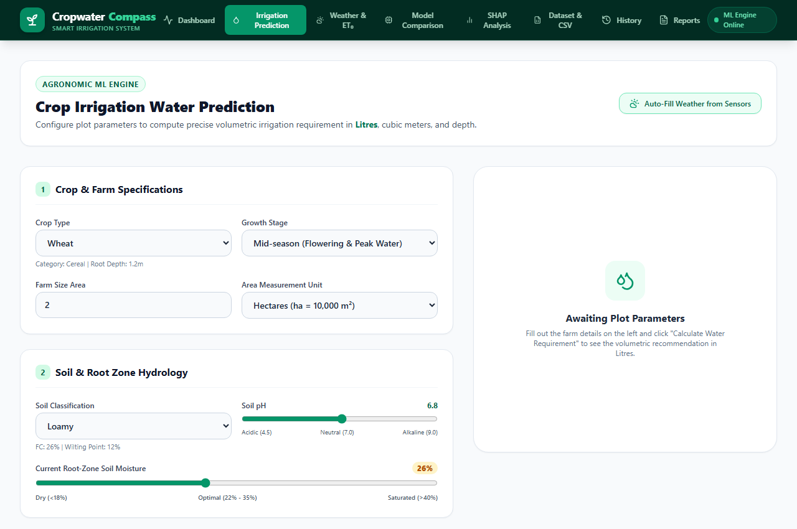

# Cropwater Compass – Smart Irrigation Management System
## Detailed Project Description & Agronomic Foundations

---

## 1. Project Overview & Motivation

Agriculture accounts for approximately **70% of global freshwater withdrawals**. In many farming regions, irrigation continues to rely on fixed time-based routines or unmetered flood methods that either over-irrigate (leading to water waste, nutrient leaching, and root rot) or under-irrigate (inducing moisture stress and depressing crop yields).

Traditional digital irrigation tools typically present a binary classification: *"Irrigation Needed: Yes or No"*. A binary trigger is insufficient for precision farming. A farmer or automated valve needs to know:
- **How much water is needed?**
- **In what units?** (Exact volume in **Litres** and cubic metres, or depth in millimeters).
- **How long should the pumps run?**
- **What is the urgency level?**

**Cropwater Compass** addresses this critical gap. It is a full-stack, machine learning–driven irrigation advisory platform that integrates **FAO-56 CROPWAT** agronomic models with modern regression machine learning (**XGBoost**, **Artificial Neural Networks**, **PyTorch LSTM**, and **Ensemble**). The system predicts the exact volumetric irrigation requirement in **Litres** for 10 major crops across 6 soil classifications and varying microclimates.

---

## 2. System Screenshots & Workflow

### Dashboard & High-Level Metrics
Executive view of water allocations, conservation statistics, and crop demand distributions.

### Field Prediction Engine
Interactive input form accepting crop type, growth stage, soil type, moisture level, weather parameters, and irrigation method, returning output in **Litres**, $m^3$, and $mm$.

### Model Benchmark & Explainability
Comprehensive performance benchmarking against test splits and SHAP waterfall feature attribution.

---

## 3. Agronomic Formulation: FAO-56 CROPWAT Standards

Cropwater Compass strictly adheres to the Food and Agriculture Organization (FAO) Irrigation and Drainage Paper No. 56 standards.

### 3.1 Reference Evapotranspiration ($ET_0$)
Reference evapotranspiration represents the evaporative demand of the atmosphere from an idealized, well-watered grass reference surface. It is calculated via the **FAO-56 Penman-Monteith equation**:

$$ET_0 = \frac{0.408 \Delta (R_n - G) + \gamma \frac{900}{T + 273} u_2 (e_s - e_a)}{\Delta + \gamma (1 + 0.34 u_2)}$$

Where:
- $T$: Mean daily air temperature at 2 m height ($^\circ\text{C}$)
- $u_2$: Wind speed at 2 m height ($\text{m/s}$)
- $R_n$: Net radiation at the crop surface ($\text{MJ/m}^2/\text{day}$)
- $G$: Soil heat flux density ($\approx 0$ for daily calculations)
- $e_s$: Saturation vapor pressure ($\text{kPa}$)
- $e_a$: Actual vapor pressure ($\text{kPa}$)
- $e_s - e_a$: Vapor pressure deficit ($\text{kPa}$)
- $\Delta$: Slope of the vapor pressure curve ($\text{kPa/}^\circ\text{C}$)
- $\gamma$: Psychrometric constant ($\approx 0.067\text{ kPa/}^\circ\text{C}$)

### 3.2 Crop Evapotranspiration ($ET_c$)
Actual crop water consumption under standard disease-free, well-fertilized conditions:

$$ET_c = K_c \times ET_0$$

Where $K_c$ is the crop coefficient determined by growth stage (Initial, Vegetative, Mid-Season, Late/Maturity).

### 3.3 Effective Rainfall ($P_{eff}$)
Not all precipitation infiltrates into the root zone; surface runoff and deep percolation carry away a portion. The USDA Soil Conservation Service formula is employed:

$$P_{eff} = \max(0, (P \times 0.8) - 5)$$

Where $P$ is total precipitation in millimeters.

### 3.4 Soil Water Dynamics
- **Total Available Water ($TAW$)**: The total capacity of the root zone to store moisture between Field Capacity ($FC$) and Permanent Wilting Point ($PWP$):
  $$TAW = 10 \times (FC - PWP) \times Z_r$$
  where $Z_r$ is rooting depth in meters.
- **Readily Available Water ($RAW$)**: The fraction of $TAW$ a crop can extract before experiencing moisture stress:
  $$RAW = p \times TAW$$
  where $p$ is the soil water depletion fraction (typically $0.40 - 0.65$ depending on crop).
- **Soil Moisture Deficit ($\Delta S$)**:
  $$\Delta S = \max\left(0, \frac{FC - \theta_{current}}{100} \times Z_r \times 1000\right)$$
  where $\theta_{current}$ is the current soil moisture percentage.

### 3.5 Net Irrigation Requirement ($NIR$)
$$NIR = \max(0, ET_c - P_{eff} + \Delta S)$$

If current soil moisture exceeds Field Capacity or effective rain exceeds evaporative demand, $NIR = 0$.

### 3.6 Gross Irrigation Requirement ($GIR$) & Unit Conversions
Irrigation application methods lose water to evaporation, drift, and non-uniform application:

$$GIR = \frac{NIR}{\eta_{irrigation}}$$

| Irrigation Method | Application Efficiency ($\eta$) |
|---|:---:|
| **Drip / Micro-irrigation** | 90% ($0.90$) |
| **Sprinkler System** | 75% ($0.75$) |
| **Surface / Flood** | 60% ($0.60$) |

### 3.7 Volumetric Output in Litres
To compute exact volume:
$$1\text{ mm of water} \times 1\text{ m}^2 = 1\text{ Litre}$$
$$\text{Water Volume (Litres)} = GIR\text{ (mm)} \times \text{Field Area (m}^2\text{)}$$
$$\text{Volume in Cubic Metres } (m^3) = \frac{\text{Water Volume (Litres)}}{1000}$$

For 1 hectare ($10,000\text{ m}^2$):
$$\text{Litres} = GIR\text{ (mm)} \times 10,000$$

---

## 4. Water Savings Estimation Methodology

The application highlights an **Estimated Water Conserved** metric on the dashboard and executive reports.

### Operational Context
- **Traditional Baseline**: Farmers practicing conventional flood irrigation typically supply water on a fixed weekly calendar, applying 50–70 mm per irrigation event regardless of actual root-zone moisture or weather. This results in heavy deep percolation below the root zone and surface runoff.
- **Precision Irrigation**: Cropwater Compass quantifies actual deficit ($\Delta S$) and atmospheric demand ($ET_c$), applying only the water required to refill the root zone to Field Capacity, adjusted for distribution efficiency.
- **Quantification**:
  $$\text{Estimated Water Conserved (Litres)} = \text{Total Evaluated Volume (Litres)} \times 0.25$$
- **Disclaimer**: This figure represents an **estimated ~25% conservation saving** against conventional unmetered flooding based on FAO-56 irrigation efficiency benchmarks.

---

## 5. Crop and Soil Catalogs

### 5.1 Supported Crops (10 Varieties)
| Crop | Category | Initial $K_c$ | Mid $K_c$ | Late $K_c$ | Root Depth ($m$) | Depletion ($p$) |
|---|---|:---:|:---:|:---:|:---:|:---:|
| **Wheat** | Cereal | 0.35 | 1.15 | 0.30 | 1.2 | 0.55 |
| **Rice / Paddy** | Cereal | 1.05 | 1.20 | 0.90 | 0.6 | 0.20 |
| **Maize / Corn** | Cereal | 0.40 | 1.20 | 0.60 | 1.2 | 0.55 |
| **Cotton** | Fiber | 0.35 | 1.20 | 0.50 | 1.4 | 0.65 |
| **Sugarcane** | Cash Crop | 0.40 | 1.25 | 0.75 | 1.5 | 0.65 |
| **Tomato** | Vegetable | 0.45 | 1.15 | 0.80 | 0.8 | 0.40 |
| **Potato** | Tuber | 0.40 | 1.15 | 0.75 | 0.6 | 0.35 |
| **Soybean** | Legume | 0.40 | 1.15 | 0.50 | 1.0 | 0.50 |
| **Barley** | Cereal | 0.30 | 1.15 | 0.25 | 1.0 | 0.55 |
| **Onion** | Vegetable | 0.50 | 1.05 | 0.75 | 0.4 | 0.30 |

### 5.2 Supported Soil Types (6 Classes)
| Soil Type | Field Capacity ($FC$) | Wilting Point ($PWP$) | Available Water ($AW$) | Infiltration Rate |
|---|:---:|:---:|:---:|:---:|
| **Sandy** | 12% | 5% | 7% | 30 mm/h |
| **Sandy Loam** | 18% | 8% | 10% | 20 mm/h |
| **Loamy** | 26% | 12% | 14% | 12 mm/h |
| **Clay Loam** | 32% | 18% | 14% | 8 mm/h |
| **Silty** | 30% | 14% | 16% | 10 mm/h |
| **Clay** | 38% | 24% | 14% | 4 mm/h |

---

## 6. Machine Learning Architecture & Evaluation

The system integrates four prediction models:
1. **XGBoost Regressor**: Gradient-boosted decision trees trained with depth 6, learning rate 0.08, and early stopping.
2. **Artificial Neural Network (ANN)**: Scikit-learn MLPRegressor with 3 hidden layers `(128, 64, 32)`, ReLU activation, Adam optimizer, and early stopping.
3. **LSTM Regressor**: A 2-layer PyTorch sequence model with 64 hidden units and dropout (0.2), simulating sequential daily moisture depletion.
4. **Ensemble Regressor**: An equal-weight blending mechanism combining predictions from all three models.

### Empirical Model Performance
Evaluated on a held-out test split (1,000 samples) from `ml/saved_models/evaluation_metrics.json`:

| Model Architecture | $R^2$ Score | RMSE ($mm$) | MAE ($mm$) | Inference Latency |
|:---|:---:|:---:|:---:|:---:|
| **PyTorch LSTM** | **0.9941** | **0.8836** | **0.5769** | 0.55 ms |
| **ANN (MLPRegressor)** | **0.9869** | **1.3182** | **0.8514** | 0.12 ms |
| **XGBoost Regressor** | **0.9595** | **2.3203** | **1.5550** | 0.73 ms |

### SHAP Explainability
Using TreeExplainer on XGBoost, the platform produces per-prediction SHAP waterfall values. The primary contributors driving irrigation volume are:
1. `et0_mm` (Atmospheric evaporative demand)
2. `rainfall_mm` (Direct moisture input)
3. `soil_moisture_pct` (Current root-zone reserve)
4. `soil_type` (Water retention capacity)

---

## 7. Dataset Details & Limitations

- **File**: `datasets/cropwater_dataset.csv`
- **Total Samples**: 5,000 complete records
- **Features**: 13 agro-climatic parameters
- **Target**: `water_requirement_mm` (Gross Irrigation Requirement)
- **Synthetic Status**: This benchmark dataset is a **synthetically generated agro-climatic dataset** generated via `ml/dataset_generator.py` using physical FAO-56 CROPWAT balance equations perturbed by $\pm 5\%$ realistic stochastic noise. It provides a standardized, leak-free benchmark for model comparison. It does not replace site-specific raw agronomic telemetry in commercial deployments.
